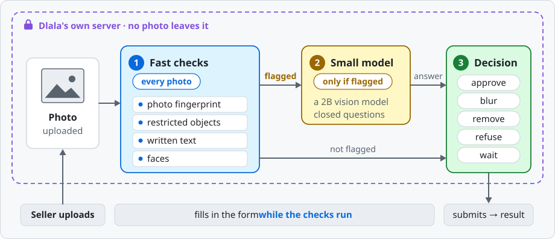
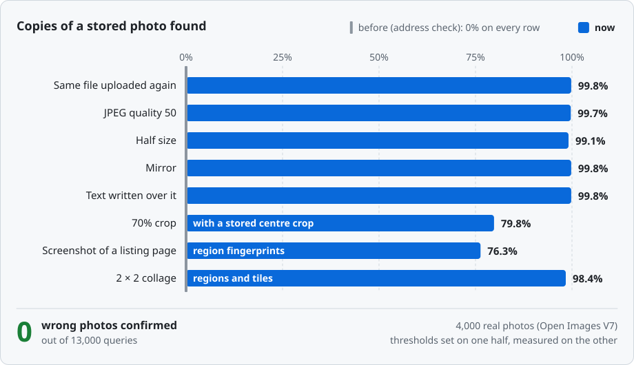

# Dlala photo trust

Photo checks for [Maison Dlala](https://maisondlala.com), a French second-hand auction site: every listing photo is
checked for copies, restricted objects and personal data by free, open models running on the site's own small server.

<picture>
  <source media="(prefers-color-scheme: dark)" srcset="docs/img/photo-journey-dark.svg">
  
</picture>

## What it catches

- **A photo copied from another listing**, even recompressed, resized, mirrored, written over, or pasted inside a
  screenshot or a collage.
- **Restricted objects** such as ivory, weapons or counterfeits. Two methods must agree before a sale is refused.
- **Faces, identity documents, number plates and addresses**, which are blurred so the sale can go on.
- **Text written to trick the system**, such as instructions to an AI inside the photo. OCR and a fixed rule judge
  it, never the model.
- **Photos taken from other sites**, recognised by another site's buttons or a phone's status bar, and removed.

## Results

<picture>
  <source media="(prefers-color-scheme: dark)" srcset="docs/img/results-dark.svg">
  
</picture>

Measured on a laptop with 4,000 real photos (Open Images V7): every threshold was chosen on one half, and the results
were measured on the other. The review this work replaces compared photo addresses, and every upload gets a new
address, so it found 0 of 50,000 copies. Methods, full tables and limits: [`docs/ML_CV.md`](docs/ML_CV.md#4-results).

## How it works

1. **Fingerprint every photo.** A PDQ hash (256 bits that survive recompression and resizing) and a DINOv2 vector
   (384 numbers that describe what the picture shows) are looked up among the stored photos.
   [More](docs/ML_CV.md#1-reused-photos)
2. **Look inside screenshots and collages.** A rectangle finder and five fixed tiles cut the image into regions,
   which are fingerprinted too. [How a copy is found](docs/ML_CV.md#how-a-copy-is-found)
3. **Prove it with geometry.** A candidate is a copy only when distinctive points (SIFT) on both photos line up
   under one transformation (RANSAC). The service returns a side-by-side evidence picture.
4. **Screen, then ask.** On every photo, SigLIP 2 scores restricted objects, OCR reads the text and YuNet finds
   faces. Only flagged photos go to a 2-billion-parameter vision model, one closed question at a time.
   [More](docs/ML_CV.md#2-visual-check)

## Built for a tiny server

<picture>
  <source media="(prefers-color-scheme: dark)" srcset="docs/img/architecture-dark.svg">
  
</picture>

The checks share an Oracle « Always Free » ARM VM with the live auctions they must not slow down.

- **Light when idle.** `vision` holds 680 MB with every model loaded and 122 MB after 10 idle minutes; the small
  model sleeps at 0.08 GB after 5.
- **The site comes first.** Both services run at low CPU priority (a quarter and an eighth of the API's weight),
  one request at a time.
- **Bidding comes first too.** During a live auction, no job calls either service.

More: [`docs/SYSTEM_DESIGN.md`](docs/SYSTEM_DESIGN.md).

## Why these choices

- **No paid AI.** Open models only: no cost per photo, and no photo leaves the server.
- **A cascade.** The small model takes 22 to 112 s per answer on one laptop CPU, so it sees only flagged photos.
- **DINOv2, not SSCD.** SSCD finds more copies, but its weights come from a non-commercial dataset (CC BY-NC).
  DINOv2 is the best descriptor that can ship.
- **fp32, not int8.** The int8 SigLIP 2 fell as low as a cosine of 0.53 to fp32, against a rule of 0.99.
- **Shadow first, law first.** New decisions run in shadow, and the code will not act until the terms of use allow
  automatic decisions (GDPR art. 22).

All the decision records: [`docs/DECISIONS.md`](docs/DECISIONS.md).

## Run it

Needs Docker and Python 3.

```bash
docker build -t dlala-vision:local service
(cd service && python3 -m app.fetch_models --lock models.lock.json \
   --dest ../artifacts/vision-models --groups vision)            # 0.46 GB, sha256-checked
MODELS_DIR=$PWD/artifacts/vision-models service/tests/run.sh     # 46 tests, inside the image
docker run --rm -p 127.0.0.1:8080:8080 -v "$PWD/artifacts/vision-models:/models:ro" dlala-vision:local
curl -s -H 'Content-Type: image/jpeg' --data-binary @photo.jpg localhost:8080/screen
```

Routes, options and error codes: [`service/README.md`](service/README.md). Both services, isolated as in
production: [`deploy/compose.example.yml`](deploy/compose.example.yml).

## What's private

This repository is a reading copy of the system's open parts: the `vision` service ([`service/`](service/)), the
evaluation sets and calibration scripts ([`eval/`](eval/)), and the design ([`docs/`](docs/)). The TypeScript API
that runs the checks stays private, with its decision rules, thresholds, OCR rules and model prompts
(`service/app/data/prompts.json` is a 10-prompt sample that shows the format). No model weights or images are
committed: they are downloaded and checked by sha256.

## Status and limits

- **Built and tested:** the `vision` service (46 tests) and the reused-photo check, calibrated on two photo sets.
- **Not calibrated yet:** the object screen's thresholds and the small model's accuracy.
- **Not measured on the ARM server yet:** every time and memory figure here comes from a laptop.
- **Weak spots:** 70 % crops (79.8 %), 15° rotations (20.5 %), and different photos of the same branded product.
  Every limit: [`docs/ML_CV.md`](docs/ML_CV.md#5-limits).

## Licence

All rights reserved unless stated otherwise; third-party components keep their licences
([`THIRD_PARTY.md`](THIRD_PARTY.md)).
