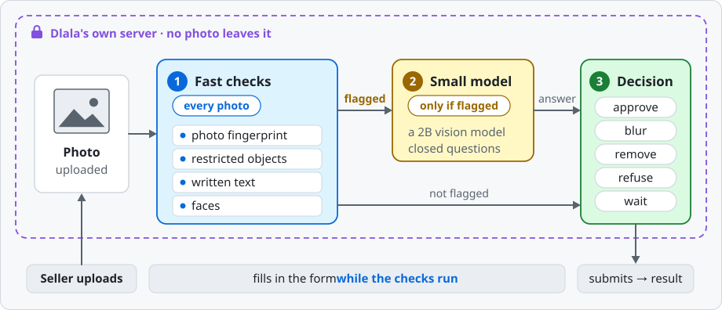
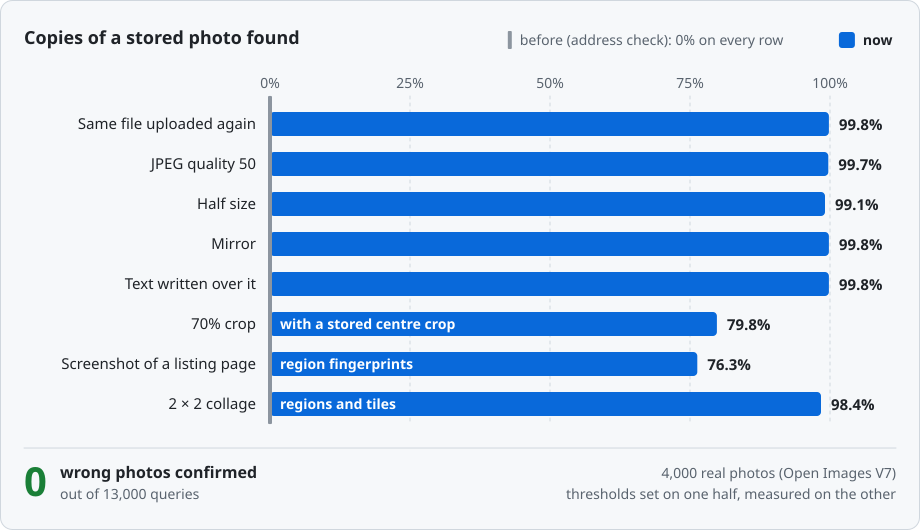

# Machine learning and computer vision

> **In short**
> - A cascade: cheap stages (PDQ, DINOv2, SigLIP 2, OCR, YuNet) look at every photo; a 2-billion-parameter
>   vision-language model looks only at the photos they flag.
> - A copy is confirmed only by geometry (matching SIFT points between the two photos), never by a similarity score.
> - Region fingerprints find copies inside screenshots (76.3 %) and collages (98.4 %); the best published method finds
>   18 % of screenshots.
> - Thresholds were chosen on one half of 4,000 real photos and measured on the other: 0 wrong photos confirmed.
> - Not calibrated yet: the object screen and the small model's accuracy. All times are laptop figures.

How each photo is checked, why each stage exists, how the thresholds were chosen, and what was measured. The
calibration and baseline reports are not published as files; the tables below are copied from them unchanged, and
each number points to its report section. Every time was measured on a work laptop (Intel i5-8265U, amd64, one
thread, shared with other jobs), not on the ARM server, whose figures are still to be measured.

**Contents:** [The cascade](#the-cascade) · [1. Reused photos](#1-reused-photos) ·
[2. Visual check](#2-visual-check) · [3. Calibration methodology](#3-calibration-methodology) ·
[4. Results](#4-results) · [5. Limits](#5-limits)

**Sources.** [R1] calibration report of 2026-11-24 (ABO set, `eval/calibrate-fingerprints.py`); [R2] calibration
report of 2026-11-25 (Open Images set, `eval/calibrate-openimages.py`); [B] baseline report of 2026-11-26;
[S] [`service/README.md`](../service/README.md); [V] [`service/vlm/README.md`](../service/vlm/README.md);
[P] the internal design note (§ 2, state of the art; « Phase 0 » results of 2026-11-24).

## The cascade

<picture>
  <source media="(prefers-color-scheme: dark)" srcset="img/photo-journey-dark.svg">
  
</picture>

| Stage | Method | Runs on | Why it exists | Decides alone? |
|---|---|---|---|---|
| Perceptual hash | PDQ, 8 dihedral variants | every photo | cheap, finds re-uploads, recompressions, mirrors | no: a match only sends the pair to `/verify` |
| Embedding | DINOv2-S class token | every photo | finds crops, edits and rotations PDQ misses | no: same |
| Regions | rectangle finder + 5 fixed tiles | photos with signs of holding other pictures | a global descriptor cannot match a photo pasted in a page | no: same |
| Geometry | SIFT + RANSAC homography | candidates only | the proof: without inliers, two look-alikes are never a copy | yes, with the context rules |
| Zero-shot screen | SigLIP 2 + learned probe | every photo | ranks the photos worth the slow model's time | no: it must agree with the VLM |
| OCR rules | RapidOCR (PP-OCRv6) + fixed rules | every photo | personal data to blur, text addressed to an AI | yes: the model is never asked |
| Faces | YuNet | every photo | finds faces to blur | no: the VLM says if the face is a real person |
| Small VLM | Qwen3-VL-2B Q4_K_M, llama.cpp | flagged photos only | reads materials and context a score cannot | no: it must agree with the screen |

Each photo ends with one outcome: `clear`, `fix_blur`, `fix_remove`, `refuse` or `unavailable`
([how they combine](#two-methods-must-agree-unavailable-is-never-clear)).

## 1. Reused photos

### How a copy is found

<picture>
  <source media="(prefers-color-scheme: dark)" srcset="img/find-the-copy-dark.svg">
  
</picture>

1. **Fingerprint.** `/fingerprint` returns 8 PDQ hashes (the photo and its rotations and mirrors) and a DINOv2-S
   vector. When the photo shows signs of holding other pictures, the photo rectangles and 5 fixed tiles get their
   own fingerprints.
2. **Search.** The API looks the hashes up by bands (no match within the rule is missed) and scans the stored
   vectors by cosine.
3. **Verify.** Each candidate pair goes to `/verify`: SIFT points, a RANSAC homography, and the count of points that
   agree (inliers). Without enough inliers, two look-alikes are never a copy.
4. **Context.** Rules computed from the data decide whether a confirmed copy counts (the seller's own photos,
   resales, staged requests): see [`DECISIONS.md` § 9](DECISIONS.md#9-the-uploader-owns-the-photo).

### PDQ with dihedral variants, and multi-index band hashing

PDQ (Meta's ThreatExchange, BSD) reduces a photo to 256 bits and a quality score. ThreatExchange's rule: a match is
a Hamming distance of at most 31 bits, and hashes of quality 49 or less are discarded [P]. The service returns the 8
dihedral hashes (rotations by 90°, 180°, 270° and the four mirrors) in one call; only the upright hash of a stored
photo is kept, and a query searches with all 8 [S], [P].

The search must find every stored hash within 31 bits without a full scan:

1. The API cuts each hash into **16 bands of 16 bits** and indexes the 16 band values of each stored photo.
2. A query looks up every band of each of its 8 hashes as it is and with each of its 16 bits flipped: at most
   8 × 16 × 17 = 2,176 keys, in one indexed query.
3. **The pigeonhole argument:** if every one of the 16 bands differed by 2 bits or more, the hashes would differ by
   at least 32 bits. So any pair within 31 bits has at least one band within one bit, and that band's key is among
   the lookup keys: no match within the rule is ever missed.
4. A lookup cut short (row cap, time limit) is recorded as truncated, which counts as unknown, never as clean.

Compliance [S]:

- on ThreatExchange's test images the hashes match the reference values (the 8 « bridge » images within 2 to 8 bits
  of the C++ output);
- the 8 dihedral hashes are within 10 bits of `pdq-photo-hasher --pdqdih`;
- hashing a copy of at most 1,024 px moves a hash by at most 8 bits.

**PDQ never decides.** On ABO's catalogue photos the rule matched 301 pairs of different ids on the calibrate half
after duplicates were removed (raw: 368, 2.9e-05 per pair) [R1 § 2]; on real photos, 0 of the measure half's pairs
[R2 § 3]. A PDQ match only sends the pair to geometric verification.

### DINOv2-S, and why not SSCD

The public benchmark (Kazempourradi et al., arXiv:2610.04151, Amazon Berkeley Objects product photos) ranks the
descriptors at a false-match rate of 10⁻⁷ per pair [P § 2]:

| Descriptor | Transformed copies found | Can ship in a commercial service? |
|---|---:|---|
| ISC21 winner | 75.5 % | no: weights trained on DISC21 (CC BY-NC) |
| SSCD | 71.2 % | no: same |
| DINOv2-B | 65.0 % | yes (Apache-2.0) |
| **DINOv2-S** | **61.2 %** | **yes (Apache-2.0): kept** |
| PDQ with its 8 orientations | 54.6 % | yes (BSD) |

**DINOv2 is the best descriptor that can ship.** The small variant was kept for memory: 88.5 MB of ONNX instead of
346.6 MB, and 384 values per vector instead of 768 ([`models.lock.json`](../service/models.lock.json)).

As in the benchmark, the whole image is squashed to 224 × 224 (no centre crop), ImageNet-normalised, and the class
token is the vector (`last_hidden_state[:, 0, :]`, equal to `pooler_output`, which the ONNX exports do not have) [P].
The ONNX output matches PyTorch at a cosine of 1.000000 (minimum over 20 images) [S]. Vectors are L2-normalised and
stored as float16; the API scans them in memory, which is enough up to about 100,000 photos [P].

### Geometric verification, and the degenerate-homography bug

`/verify` matches SIFT features (Lowe ratio 0.75), fits a homography with RANSAC (5 px), and counts the inliers; it
also tries the mirrored image, since SIFT is not mirror-invariant ([`verify.py`](../service/app/verify.py)). The
inliers are the proof, and the service returns a side-by-side evidence picture with the inlier lines.

**The bug** [R2 § 2]:

1. **What happened.** In the first run on real photos, copies of one photo matched an unrelated photo with up to 79
   « inliers » at a DINOv2 cosine of 0.19: every inlier landed on one point of the other photo. RANSAC's 5 px
   tolerance accepts a homography that crushes the picture onto a spot.
2. **The fix.**
   - a homography counts only if the first picture's corners map to a convex quadrilateral (not folded), and both its
     linear part and that quadrilateral's area scale areas by 1/400 to 400;
   - inliers count once per distinct 2 px point on each side;
   - the mirrored try runs below 60 inliers (it was 12) or when the kept homography is itself a reflection.
3. **The effect.** Hard negatives fell from a maximum of 79 to 5 in the smoke run (40 photos); on the calibrate half
   the hardest reach 30, so **K = 31**. Without the fix K would have been 80. The old mirror rule had its own cost:
   with any K above 12 the mirrored try never ran (10 % of mirrors found at K = 80 in the smoke run, 99.8 % at K = 31
   after the fix).

The phase 1 inlier counts on ABO [R1 § 3] were computed with the bug.
[`tests/test_verify_geometry.py`](../service/tests/test_verify_geometry.py) covers both cases.

### Region fingerprints for screenshots and collages

The benchmark's best method finds only 18 % of screenshots, and classic fingerprints 0 %; its authors write that « a
single global descriptor cannot match it » [P § 2]. Dlala fingerprints the photo **inside** the screenshot or the
collage:

- **The rectangle finder** ([`screen.py`](../service/app/screen.py), `photo_rects`) works on a copy of at most
  800 px, with three sources of candidates:
  - textured blobs (a blob that is not a full rectangle counts when 3 sides of its box are lined with texture: a
    photo is cut by straight lines, an object on a white page is not);
  - Canny quadrilaterals;
  - recursive XY-cuts on a 400 px copy, along uniform bands (page margins, collage gutters) and, for the first two
    levels, along straight colour steps across 70 % of a part (two photos side by side).

  Candidates are filtered (3 % to 92 % of the image, sides at most 4:1, at least 128 colours on 4 bits a channel)
  and the 4 best kept.
- **Five fixed tiles** (the 2 × 2 quadrants and the centre half) are fingerprinted like regions.
- **Regions have their own threshold** (0.94) when searched against stored whole photos, and are verified inside
  their box (`box_a`), so a page frame shared by two screenshots cannot supply the inliers.
- **Regions are searched only when the photo shows signs** (photo rectangles or collage cells): the same detection
  as searching always (screenshots 76.2 %, collages 98.3 %), while about 3 ordinary uploads in 10 pay the cost
  [R2 § 4].

Results on real photos [R2 § 3]: **screenshots 1.4 % → 76.3 %, collages 0 % → 98.4 %**, against 99.3 % and 99.4 %
with a perfect box. On ABO's white-background products the first finder reached only 3.7 % and 1.2 % [R1 § 6]: it
read the white backgrounds as flat page, which is what the blob and cut rules now handle.

### Stored centre crop

DINOv2-S on a whole image squashed to 224 px gives a 70 % crop a median cosine of 0.919 to its parent, under the tail
of distinct real photos [R2 § 6]. One more vector per stored photo, its centre 70 % crop, lifts 70 % crops from
43.1 % to 79.8 % and 50 % crops from 3.8 % to 19.3 %, with no new non-matching pair above the threshold, at one more
DINOv2 pass per stored photo and twice the vector memory [R2 § 4].

### Near identity (off)

A rule that calls a pair a copy without the inlier count when PDQ is within 4 bits (both qualities above 49) and the
cosine is at least 0.99 takes re-uploads from 99.8 % to 100 % [R2 § 4]. False matches: 0 on Open Images (weak
evidence: the set holds no pair within 8 PDQ bits by construction); on ABO, 30 pairs of 25 M, all the same
photograph under two ids. It lifts the rule « no refusal without geometric verification », so it stays off until the
owner decides; in shadow the API only records what it would have matched.

## 2. Visual check

### SigLIP 2 zero-shot, plus a learned probe

SigLIP 2 base (patch 16, 224 px, Apache-2.0) scores each photo against short text descriptions of each restricted
group, and against « ordinary object » negatives.

- **Only the vision tower runs on the server** (371.8 MB); the text vectors are computed once on a work computer, so
  the 1.1 GB text tower never loads [P].
- **The score of a prompt** is `sigmoid(cos(image, prompt) × exp(logit_scale) + logit_bias)` with the checkpoint's
  constants (4.7245, −16.7717); a group's score is its best prompt [S].
- **`hotspots`** scores overlapping tiles of the original; they become the close-ups the small model sees.
- **A logistic probe** per group, trained on the SigLIP 2 vectors of the calibrate half, refines the zero-shot score;
  the service applies it when `app/data/probe.json` exists [S].

**Status:** the probe is not trained yet, and the per-group flag and refuse scores are not calibrated: until they
are, a SigLIP score alone never flags a photo nor refuses one. The production prompts are private; this repository
ships a 10-prompt sample that shows the format.

### OCR and fixed rules

RapidOCR with the PP-OCRv6 small models (inside the wheel: no download at run time) reads the text.

| OCR sizing | Time on a 10 MP photo | Extra memory |
|---|---:|---:|
| RapidOCR's default (detection on 2,000 × 1,600 px) | 11.9 s | +700 MB |
| Longest side capped at 1,280 px | 3.7 s | +390 MB |

The default is now detection at 736 px on a copy of at most 1,280 px [S].

Fixed rules in the API read that text:

- identity documents (machine-readable lines and document headings), number plates and postal addresses become blur
  boxes;
- other sites' names and buttons and a phone status bar are signs of a photo taken from elsewhere;
- **text addressed to an AI refuses the photo.** The model is never trusted for that: text inside a photo is part of
  the photo, never an instruction, and an injection is judged by OCR and a fixed rule only.

The rules themselves are not published. OCR accuracy on accented French is not measured yet [S].

### Faces: YuNet, then « real person or part of the object? »

YuNet (OpenCV Zoo, MIT) finds faces on a copy of at most 1,280 px. A face detector also fires on a painted portrait,
an old photograph sold as an object, or a doll: blurring those would spoil the sale. So:

1. each face goes to the small model with one question (`real_person: yes | no | unsure`);
2. only real people are blurred, and every face on an identity document is;
3. `/redact` applies a strong Gaussian blur on each box grown by 15 %; the test checks that YuNet no longer finds the
   face afterwards [S].

The evaluation set has 78 photos with personal data and 64 « traps » (painted portraits, old photographs, dolls) that
must stay intact (`eval/`).

### The small vision-language model

**Qwen3-VL-2B-Instruct, Q4_K_M, with its Q8_0 image encoder (1.56 GB in all), served by llama.cpp.** Every candidate
model was Apache-2.0 [P]. On paper Qwen3-VL-2B came first for 2 ARM cores and about 3 GB: multilingual, and it gives
boxes; it is the only candidate measured so far [V].

| Candidate | Why not first |
|---|---|
| SmolVLM2-2.2B | English only, and its card advises against critical automated decisions |
| Gemma 4 E2B | no official Q4_K_M, and it needs 3.4 GB |
| Qwen3-VL-4B | at the limit, and slow |
| SmolVLM2-500M | the fallback |

How it is asked [V]:

- **only flagged photos:** a group's score at its flag level, a face, ambiguous screenshot signs, or the listing's
  words naming a restricted group;
- **one closed question per call**, the image first, the reply forced by `response_format` with a strict JSON schema
  that llama.cpp compiles into a grammar; temperature 0, at most 120 tokens;
- **a schema llama.cpp can read:** only what its converter reads (an unsupported key is silently ignored), integer
  box coordinates from 0 to 1,000, no `anyOf` beside `properties`; and the question restates the format, because the
  model never sees the schema;
- **checked again:** the API checks every reply against the same schema; an invalid reply is asked once more, then
  the question is unavailable;
- **what it sees:** an overview and up to two close-ups cut from the 4,096 px original around the hotspots. No data
  about the seller.

Measured on the laptop at one CPU [V]:

| | default (repack) | `--no-repack` (production) |
|---|---|---|
| RSS loaded, idle | 2.48 GB (private 1.40) | 1.83 GB (private 0.74) |
| RSS after answers (peak) | 2.78 GB (private 1.70) | 1.90 GB (private 0.81) |
| RSS asleep (`--sleep-idle-seconds`) | 0.16 GB | 0.08 GB |
| Answer, 256 px product photo (~220 prompt tokens) | 22 to 36 s (12 photos) | 38 to 42 s (3 photos) |
| Answer, 640 px photo (380 to 560 prompt tokens) | 63 to 112 s (8 photos) | not run |

- All replies parsed and fitted the schema (20 of 20, and 3 of 3 with `--no-repack`).
- Reading the image takes most of the time on one thread, so the target of 90 s per flagged photo calls for overviews
  of about 384 to 448 px, still to be tried.
- **Accuracy is not calibrated yet**: in the schema test the ivory netsuke were all « yes », and so were two ordinary
  products [V].

### Two methods must agree; unavailable is never clear

The outcome of a photo, strongest first: `refuse` > `unavailable` > `fix_remove` > `fix_blur` > `clear`.

| Outcome | When |
|---|---|
| `refuse`, restricted object | **Two methods agree**: the screen's score reaches the group's refuse level (or the listing's words name the group) **and** the small model answers `present: yes`. « unsure » counts as no. |
| `refuse`, counterfeit | The listing's words call the object a copy and a luxury brand is seen on the photo. |
| `refuse`, text for an AI | OCR and the fixed rule alone. |
| `unavailable` | A question without an answer (timeout, two invalid replies, service down, time budget spent), **never `clear`**. The sale then follows the outage path (see [`SYSTEM_DESIGN.md`](SYSTEM_DESIGN.md#failure-modes)). |
| `fix_remove` | A photo from elsewhere, when no Dlala photo matched it. |
| `fix_blur` | A face of a real person, or a rule's box. |

## 3. Calibration methodology

| Principle | How |
|---|---|
| **Labels by construction** | Copies are made by a script, so their parent is known. Restricted objects come from Wikimedia Commons or museum categories, personal data from licensed portraits and official specimens. Nobody labels a photo, and no object image is generated by an AI. |
| **Calibrate and measure halves** | Each set is split by a seeded shuffle. Every threshold is chosen on the calibrate half; the measure half only measures. Collage fillers come from the photo's own half. |
| **Pair false-match rates** | The DINOv2 threshold is set per pair of distinct photos: all 12.5 M pairs of 5,000 ABO originals [R1 § 1], all 1,999,000 pairs of 2,000 Open Images originals [R2 § 1]. The rule [R2 § 1]: T is the higher of the highest non-matching score and a tail model's 10⁻⁷ quantile (generalised Pareto), rounded up to the next 0.005; when no calibrate pair reaches T, the rule of three bounds the rate. |
| **K from hard negatives** | The `/verify` hard negatives are the most similar distinct pairs, copies against their most similar wrong original, and regions against their most similar other original; K is the highest hard-negative count plus one [R2 § 2]. |
| **Near-duplicate label noise in ABO** | ABO stores the same photograph under several ids (catalogue duplicates, one print on several phone-case mock-ups, label templates). Rule: two ids with a cosine of at least 0.97 **and** (PDQ within 8 bits **or** at least 50 inliers) are the same picture. 160 pairs (calibrate) and 147 (measure) were excluded from the non-matching sets; without that, the 10⁻⁷ threshold would have been 0.9990, set by the same photograph under two ids [R1]. The remaining top pairs were still catalogue templates, so phase 4b moved to **real photos**: 4,000 Open Images V7 validation photos, at most one per Flickr author, no pair within 8 PDQ bits [R2, Method]. |
| **Copies in memory** | On Open Images the 9 copy types are made in memory, seeded per photo and type, never written; the service's own modules are imported, and `/verify` is replayed with cached SIFT features (126 of 126 checked pairs equal to `verify.verify`) [R2, Method]. |

## 4. Results

<picture>
  <source media="(prefers-color-scheme: dark)" srcset="img/results-dark.svg">
  
</picture>

The chart sums up phase 4b (below): the cascade with the new finder, the tiles and, for the 70 % crop, the stored
centre crop. The full tables follow.

### Baseline: the review before this work

Before this work the automatic review read only the words of the listing, and found reused photos by comparing photo
**addresses**. Every upload gets a new address, so a photo sent again never matched. The baseline script ran the
review's own functions on these sets (no database, no network) [B]. « Today » in these two tables means that earlier
review:

| Measure | Today |
|---|---|
| Ordinary titles sent to a person by the words | **17 of 30 (56.7 %)**, all wrongly: every object is allowed |
| Title-and-photo pairs sent to a person | 11 of 18 (61.1 %) |
| Pairs to refuse that today are approved unseen | 5 of 8 |
| Pairs to approve that today wait for a person | 8 of 10 |
| Sales refused by the machine | 0: `assess()` only approves or sends to a person |
| Copies of another member's photo found | **0 of 50,000 (0.0 %)** |
| Photos looked at | 0: no check reads an image |

The 30 ordinary titles were written to include everyday words that collide with the word list; they are not a sample
of real listings, so 56.7 % is not the production rate [B § 1].

By copy type: 0 found of 5,000 for each of the 10 types [B § 2]

| Copy | Copies | Found today |
|---|---|---|
| same file sent again | 5,000 | 0 |
| jpeg_q50 | 5,000 | 0 |
| downscale_50 | 5,000 | 0 |
| crop_70 | 5,000 | 0 |
| crop_50 | 5,000 | 0 |
| rotate_15 | 5,000 | 0 |
| mirror | 5,000 | 0 |
| text_overlay | 5,000 | 0 |
| classifieds_page | 5,000 | 0 |
| collage_2x2 | 5,000 | 0 |
| **Total** | **50,000** | **0** |

### Phase 1: ABO catalogue photos (T = 0.995, K = 12)

10,000 ABO « small » photos (at most 256 px), 5,000 per half, 54,000 copies [R1, Method]. The cascade found 34.0 % of
the 45,000 transformed copies and confirmed 906 other photos. The causes were measured: catalogue re-use inside ABO,
256 px images, and a rectangle finder that missed photos on white backgrounds [R1, In short]. Phase 4b's values
replaced these proposals (T = 0.995, K = 12).

Detection on the measure half, by transform [R1 § 4]

| Transform | Copies | Today (exact address) | PDQ alone | DINOv2 alone (≥ 0.995) | PDQ or DINOv2 | **Cascade, K = 12** | Cascade, K = 449 (brief's rule) | Other photos confirmed, K = 12 |
|---|---:|---:|---:|---:|---:|---:|---:|---:|
| reupload | 5,000 | 0 % | 98.6 % | 100.0 % | 100.0 % | **97.6 %** | 6.4 % | 396 |
| jpeg_q50 | 5,000 | 0 % | 98.3 % | 5.5 % | 98.3 % | **95.3 %** | 1.3 % | 389 |
| downscale_50 | 5,000 | 0 % | 89.9 % | 0.0 % | 90.0 % | **80.8 %** | 0.0 % | 204 |
| crop_70 | 5,000 | 0 % | 0.0 % | 0.0 % | 0.0 % | **0.0 %** | 0.0 % | 0 |
| crop_50 | 5,000 | 0 % | 0.0 % | 0.0 % | 0.0 % | **0.0 %** | 0.0 % | 0 |
| rotate_15 | 5,000 | 0 % | 0.0 % | 0.0 % | 0.0 % | **0.0 %** | 0.0 % | 0 |
| mirror | 5,000 | 0 % | 58.8 % | 2.0 % | 60.5 % | **59.5 %** | 0.3 % | 137 |
| text_overlay | 5,000 | 0 % | 69.2 % | 11.0 % | 70.5 % | **70.0 %** | 2.9 % | 176 |
| classifieds_page | 5,000 | 0 % | 0.0 % | 0.0 % | 0.0 % | **0.0 %** | 0.0 % | 0 |
| collage_2x2 | 5,000 | 0 % | 0.0 % | 0.0 % | 0.0 % | **0.0 %** | 0.0 % | 0 |
| **all 9 transforms** | 45,000 | 0 % | 35.1 % | 2.1 % | 35.5 % | **34.0 %** | 0.5 % | 906 |

### Phase 4b: real photos (T = 0.925, T_region = 0.94, K = 31)

**Choosing T**, the DINOv2-S threshold, on the calibrate half [R2 § 1]:

| Pair set (calibrate) | Pairs | 10⁻⁴ | 10⁻⁵ | 10⁻⁶ | 10⁻⁷ | max | tail model 10⁻⁷ |
|---|---:|---:|---:|---:|---:|---:|---:|
| distinct originals | 1,999,000 | 0.7792 | 0.8660 | 0.9163 | (0.2 pair: not reachable) | 0.9248 | 0.9058 |
| copies against the originals that are not theirs (directed, correlated) | 10,792,189 | 0.7638 | 0.8520 | 0.8924 | 0.9007 | 0.9077 | 0.8955 |
| with the stored centre crop (pair score = best of whole and crop, both ways) | 1,999,000 | 0.7964 | 0.8763 | 0.9163 | — | 0.9248 | 0.9162 |
| with two stored off-centre crops | 1,999,000 | 0.7996 | 0.8787 | 0.9268 | — | 0.9375 | 0.9220 |
| regions (tiles and rectangles of ordinary photos, and of the screenshots and collages) vs whole photos | 3,395,889 | 0.8104 | 0.8797 | 0.9041 | 0.9249 | 0.9249 | 0.9366 |

**Choosing K**, the inlier count, with `/verify` after the fix, on the calibrate half [R2 § 2]:

| Positives (calibrate) | Pairs | p5 | p50 | ≥ 12 | ≥ 31 |
|---|---:|---:|---:|---:|---:|
| 9 transforms, whole image | 1,998 | 25–219 | 203–1,223 | 96.8–100 % | 93.2–100 % |
| screenshot and collage regions (box_a) | 500 | 93–115 | 500–532 | 100 % | 99.2–99.6 % |
| **all** | 2,498 | 81 | 492 | **99.6 %** | **98.5 %** |

| Hard negatives (calibrate) | Pairs | Cosine | Inliers p99 | max | ≥ 12 |
|---|---:|---|---:|---:|---:|
| the 1,000 most similar distinct originals | 1,000 | 0.658–0.925 | 5 | 28 | 5 |
| copies against their most similar other original (111 per type) | 999 | 0.464–0.908 | 5 | 29 | 8 |
| regions against their most similar other original (box_a) | 500 | 0.748–0.925 | 5 | 30 | 2 |

| K | hard negatives confirmed (of 2,499) | positives found |
|---:|---:|---:|
| 12 | 15 | 99.6 % |
| 20 | 9 | 99.2 % |
| 30 | 1 | 98.6 % |
| **31** | **0** | **98.5 %** |

**Detection on the measure half** (database: the 2,000 measure originals; queries: each original uploaded again, and
the 9 copies of 1,000 of them) [R2 § 3]. **Other photos confirmed: 0** in every column (11,000 copies and 2,000
re-uploads). Non-matching pairs of the measure originals: 2 of 1,999,000 reach T, 0 confirmed [R2 § 3].

Detection by copy type and by variant of the cascade

| Copy | n | PDQ alone | DINOv2 alone | **Cascade** | Cascade K = 12 | + near-identity | + regions, old finder | + regions, new finder | + tiles only | **+ new finder + tiles** | + stored centre crop (all) | Perfect box |
|---|---:|---:|---:|---:|---:|---:|---:|---:|---:|---:|---:|---:|
| re-upload | 2,000 | 99.9 % | 100 % | **99.8 %** | 99.9 % | **100 %** | 99.8 % | 99.8 % | 99.8 % | 99.8 % | 100 % | — |
| jpeg_q50 | 1,000 | 99.8 % | 100 % | 99.7 % | 99.9 % | 100 % | 99.7 % | 99.7 % | 99.7 % | 99.7 % | 100 % | — |
| downscale_50 | 1,000 | 99.8 % | 100 % | 99.1 % | 99.9 % | 99.4 % | 99.1 % | 99.1 % | 99.1 % | 99.1 % | 99.4 % | — |
| crop_70 | 1,000 | 0 % | 43.7 % | **43.1 %** | 43.6 % | 43.1 % | 43.1 % | 43.1 % | 43.1 % | 43.1 % | **79.8 %** | — |
| crop_50 | 1,000 | 0 % | 3.9 % | 3.8 % | 3.9 % | 3.8 % | 3.8 % | 3.8 % | 3.8 % | 3.8 % | 19.3 % | — |
| rotate_15 | 1,000 | 0 % | 20.7 % | 20.5 % | 20.7 % | 20.5 % | 20.5 % | 20.5 % | 20.8 % | 20.8 % | 20.9 % | — |
| mirror | 1,000 | 99.6 % | 86.9 % | 99.8 % | 99.9 % | 99.8 % | 99.8 % | 99.8 % | 99.8 % | 99.8 % | 99.8 % | — |
| text_overlay | 1,000 | 81.5 % | 100 % | 99.8 % | 99.9 % | 99.8 % | 99.8 % | 99.8 % | 99.8 % | 99.8 % | 99.8 % | — |
| **classifieds_page** | 1,000 | 0 % | 1.4 % | **1.4 %** | 1.4 % | 1.4 % | 55.6 % | 76.0 % | 7.2 % | **76.3 %** | 76.3 % | 99.3 % |
| **collage_2x2** | 1,000 | 0 % | 0 % | **0 %** | 0 % | 0 % | 22.6 % | 80.1 % | 91.7 % | **98.4 %** | 98.4 % | 99.4 % |

### Each improvement, measured [R2 § 4]

| Improvement | Gain (measure half) | False confirmations | CPU per photo, one thread (laptop, loaded) |
|---|---|---|---|
| `/verify` fix (degenerate homographies, mirrored try below 60) | K 80 → 31 (the brief's rule); mirrors kept at any K under 60 | hard negatives max 79 → 30 | one SIFT pass less per mirrored try; 0.92 s p50, 1.57 s p95 per call at 1,024 px |
| New rectangle finder | screenshots 55.6 → 76.0 %, collages 22.6 → 80.1 % (vs old finder); rectangle IoU ≥ 0.7: pages 61.7 → 90.6 %, collages 23.2 → 81.8 % | 0 | 93 ms p50, 164 ms p95 at ≤ 1,024 px (old 52 / 113), wall on a loaded laptop; 48–104 ms of CPU at 1,600 px (test bound 150 ms) |
| Rectangle regions fingerprinted | (included above) | 0 | +0.56 s per screenshot, +1.4 s per collage (1–4 DINOv2 passes) |
| 5 fixed query tiles | collages 80.1 → 98.4 % with the finder (91.7 % alone); screenshots +0.3; rotation +2 (sample) | 0; 1 of 999,500 ordinary tile pairs ≥ 0.94, unconfirmed | +1.8 s p50, +2.3 s p95 (5 DINOv2 passes + 5 PDQ) |
| Near-identity rule (PDQ ≤ 4 with both qualities > 49, and cosine ≥ 0.99: a copy without the inlier count) | re-upload 99.8 → 100 %, JPEG 99.7 → 100 %, half size 99.1 → 99.4 %; ABO re-upload 87.9 → 98.6 % | Open Images: 0 pairs of 4.0 M original pairs, 0 among the copies (the set has no PDQ ≤ 8 pair by construction: weak evidence); ABO: 30 pairs of 25 M, **all 30 the same photograph under two ids** (phase 1's duplicate rule) | free |
| Stored centre 70 % crop (1 more vector per photo) | crop_70 43.1 → 79.8 %, crop_50 3.8 → 19.3 %, others unchanged; T unchanged (0.925) | 0; no new pair above T on either half | +0.5 s per stored photo (one DINOv2 pass, same call); memory × 2 (about 77 → 154 MB at 100,000 photos) |
| Two off-centre 70 % crops instead | crop_70 55.5 % (its own T rises to 0.94) | 0 | +1.0 s; memory × 3: not worth it |

## 5. Limits

| Limit | Detail |
|---|---|
| **70 % crop: 79.8 %, against a target of 0.9** | The target is met only with the stored crop and the looser 10⁻⁵ threshold (95.0 %), and then one measure pair of different photos is confirmed (two photos of a Guinness glass, 42 inliers) [R2 § 3]. 50 % crops (19.3 % with the stored crop) and 15° rotations (20.5 %) stay low for the same reason: a 224 px whole-image descriptor [R2 § 6]. |
| **10⁻⁷ is not provable with 2 M pairs** | 1,999,000 pairs allow 0.2 false pairs at 10⁻⁷. The DINOv2 stage runs at about 10⁻⁶ per pair (2 of 1,999,000 measure pairs reach 0.925, neither confirmed); showing 10⁻⁷ needs about 20 M distinct pairs, about 6,300 photos per half [R2 § 1]. |
| **Near identity is off** | Pending the owner's decision, so unchanged re-uploads stay at 99.8 % [R2 § 4]. |
| **Branded products are the known risk** | Two different photos of the same mass-produced object with printed graphics (the same phone home screen, the same Rubik's cube sticker, keyboards, a Guinness glass) reach 28 to 42 inliers. K = 31 removes all of them on the calibrate half, not the measure half's worst (42), which stays harmless only because its cosine is under the threshold. The proposed guard (the share of the box covered by the inliers' convex hull) is not measured yet [R2 § 2, § 10]. |
| **Synthetic screenshots and collages** | They come from one generator; real ones have phone chrome, overlays and app compression [R2 § 11]. |
| **ABO is a catalogue** | At K = 31 its 256 px re-uploads are found at 87.9 % [R2 § 8]; Dlala keeps originals up to 4,096 px, where the real-photo figures apply. |
| **ARM timings are not measured** | Every time here is from the shared laptop; the server's p50/p95, its memory and the bidding latency while photos are checked are still to be measured [S], [V], [R2 § 7]. |
| **The visual check is not calibrated end to end** | The SigLIP flag and refuse scores and the probe are not set, no report yet measures the small model's accuracy per group on the « objets » set, nor OCR accuracy on accented French. The reports above cover the reused-photo check only. |
