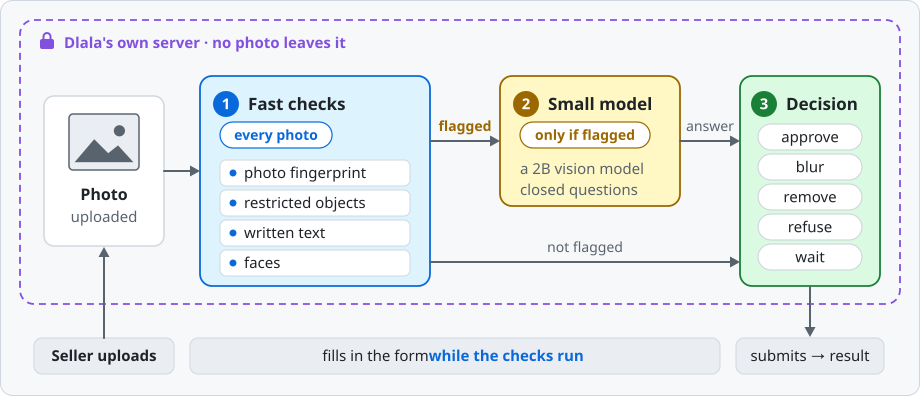

# System design

> **In short**
> - The photo checks run on the marketplace's one small server (an ARM VM with 5.9 GB of RAM), next to live
>   auctions they must never slow down.
> - Two stateless services do the work: `vision` (fast checks, every photo) and `vlm` (a small model, flagged photos
>   only). They sit on an internal network with no internet.
> - The analysis starts at upload, in a background worker; the review at submission only reads stored results.
> - A failure makes a photo « unavailable », never « clear »: the sale waits, or goes live with what is finished.
> - Originals stay private and temporary, GPS is never read, and the code will not act on its own until the terms of
>   use allow automatic decisions.

The orchestration (the TypeScript API) is private; this document describes it so the service in
[`../service/`](../service/) can be read in context. Machine-learning details and results: [`ML_CV.md`](ML_CV.md).
The choices: [`DECISIONS.md`](DECISIONS.md).

**Contents:** [Constraints](#constraints) · [Components](#components) ·
[From upload to decision](#from-upload-to-decision) · [Jobs, waits and resumption](#jobs-waits-and-resumption) ·
[Resource isolation](#resource-isolation) · [Failure modes](#failure-modes) · [Security](#security) ·
[Privacy](#privacy) · [Rollout and the legal guard](#rollout-and-the-legal-guard)

**Sources.** [S] [`service/README.md`](../service/README.md); [V] [`service/vlm/README.md`](../service/vlm/README.md);
[C] [`deploy/compose.example.yml`](../deploy/compose.example.yml); [P] the internal design note (« Phase 0 » results
of 2026-11-24, § 2 bis, phases 2 to 6). Every time and memory figure was measured on a work laptop, not on the ARM
server.

## Constraints

| Constraint | What it means |
|---|---|
| **One server, already full** | Dlala runs on one Oracle Cloud « Always Free » Ampere A1 VM. Measured on 2026-11-24: 5,901 MB of memory (3,427 MB available) and 45 GB of disk. The CPU count is still to be measured; 5.9 GB matches the free tier's default shape of 1 OCPU and 6 GB [P § 8]. The API, MongoDB, ClamAV, the web front ends and the live-auction media server already run there. The free tier allows 2 OCPU and 12 GB per tenancy; going past it makes the account paying [P § 9]. |
| **A memory budget for the models** | About 1.2 GB steady and 2.2 GB at peak, leaving at least 1 GB of page cache to MongoDB [P § 8]. |
| **No paid AI, no photo leaves the server** | Every model is open, free and local; the cost is CPU time [P]. |
| **Keep bidding fast** | Live auctions must not slow down. The photo checks always give way to the auction. |
| **« After sell, it is live »** | A clean sale opens as soon as the seller submits the form; the checks may not add a step for it. |
| **No person in the loop** | Except when a seller contests a decision, which the law requires ([Rollout and the legal guard](#rollout-and-the-legal-guard)). |

## Components

<picture>
  <source media="(prefers-color-scheme: dark)" srcset="img/architecture-dark.svg">
  
</picture>

| Component | What it is | State |
|---|---|---|
| API (private, TypeScript) | Upload intake; the photo worker and its steps (fingerprint, reuse search, screen, small model, outcome); the review that reads the results; automatic decisions, waits, the breaker and the self-test. It publishes a copy of each photo of at most 1,600 px. | MongoDB (`PhotoAnalysis` records) |
| `vision` ([`service/`](../service/)) | Python 3.12, standard-library HTTP server, ONNX Runtime and OpenCV on the CPU. Routes `/fingerprint`, `/screen`, `/verify`, `/redact`, `/health` [S]. Models: PDQ, DINOv2, SigLIP 2, OCR, YuNet, SIFT. | none: each request carries its images |
| `vlm` | llama.cpp's own server image, pinned by digest, running Qwen3-VL-2B Q4_K_M. No code of ours runs in it [V]. | none |
| `vision` network | Docker network with `internal: true`: no gateway, so nothing on it reaches the internet [C]. | — |
| Models volume | Filled once by a fetch step that checks each file's size and sha256 against [`models.lock.json`](../service/models.lock.json); mounted read-only. | files |
| Originals volume | The API's private folder of upright originals, never served. | files, deleted after use |

Both services are stateless, so one pair serves the production site and its read-only showroom without sharing
anything between them.

## From upload to decision

<picture>
  <source media="(prefers-color-scheme: dark)" srcset="img/photo-journey-dark.svg">
  
</picture>

**At upload** (the seller is still filling in the form):

1. The seller uploads a photo; the API answers at once with the published copy.
2. The API stores an EXIF summary without GPS, keeps the original privately, and queues a job.
3. The photo worker claims the job with a lease.
4. `vision /fingerprint` returns the 8 PDQ hashes and the DINOv2 vector; the API runs the band lookup and the cosine
   search over stored photos.
5. If there are candidates, `vision /verify` counts the SIFT inliers and returns an evidence picture.
6. `vision /screen` runs SigLIP 2, OCR, face detection and the photo-rectangle finder.
7. If it finds photo rectangles or collage cells, the regions and tiles are fingerprinted, searched and verified.
8. If the photo is flagged, `vlm` gets one closed question per call with a JSON schema, and returns an answer or
   « unavailable ».
9. If there are boxes to blur, `vision /redact` blurs them.
10. The worker stores the outcome and its reasons.

**At submission:**

11. The seller submits the sale form, and the API reads the stored results.
12. If every photo is analysed, the sale is approved and live, corrected, or refused with a statement of reasons. If
    photos are still running, the sale waits, and goes on by itself when the analysis ends.

What this order guarantees:

- **The analysis starts at upload**, while the seller fills in the rest of the form; the review at submission reads
  stored results and never calls a model inside a request [P].
- **The upload never waits.** The image is held in memory only until its original is written, and the intake gives
  way to other uploads [P].
- **Corrections are applied before the content is stored**: a blurred copy replaces its photo and a photo from
  elsewhere is dropped, so what is stored is what is published.

## Jobs, waits and resumption

| Mechanism | How it works |
|---|---|
| **Jobs** | The worker takes one queued analysis at a time with a conditional `findOneAndUpdate` and a lease, so several API instances never take the same job, and an expired lease (a crash) is taken again. A failure is retried later, with a growing delay, a bounded number of times. A sweep every 30 s drains the queue. Each member has a daily cap: past it, their photos wait their turn. |
| **Steps keep their results** | An interrupted run keeps the steps already done; a slow step (the small model) extends its lease first, and stops if it lost it. |
| **Waiting sales resume by themselves** | A request that waits (photos still running, an email to confirm, a payout account to finish, a 24-hour window) is assessed again on the event that lifts the wait, and by a sweep every minute, with a conditional update so two instances never decide twice. If it passes, it opens at once. |

## Resource isolation

| | `vision` | `vlm` |
|---|---|---|
| CPU | `cpus: 0.75`, `cpu_shares: 256` (a quarter of the API's weight); one ONNX thread | `cpus: 1.0`, `cpu_shares: 128` (an eighth); one thread for generation and for the prompt |
| Concurrency | one request computed at a time, at most 4 waiting, each up to 60 s, then 503 | `-np 1`, short context (`-c 2048`), at most 512 tokens per image |
| Memory limit | 1,200 MB, no swap; measured peak 937 MB on 4,096 px photos, steady 680 MB [S] | 2,048 MB, no swap; measured peak 1.90 GB, of which 1.07 GB are mapped model pages [V] |
| Idle | models unloaded after 10 idle minutes: 122 MB left [S] | model unloaded after 5 idle minutes: 0.08 GB [V] |

| Guard | What it does |
|---|---|
| **Idle unload** | Nobody sells most of the time: both services give their memory back when idle and reload on the next request, a few seconds for `vision` and about 19 s for the model [S], [V]. |
| **`--no-repack`** | Keeps the model's weights in the mapped file instead of a private repacked copy: 0.81 GB of private memory instead of 1.70 GB, for answers about 40 % slower [V]. |
| **The live-auction pause** | While a live sale is on air or about to open, or a timed lot is in its last minutes, no job calls `vision` or `vlm` at all; jobs are deferred without counting an attempt. Past a maximum deferral, the fast check runs and the small model's questions are given up (unavailable) rather than make a slow call during bidding. |
| **The memory guard** | The small model waits while the host's available memory is under a configured floor: once loaded, it takes about 0.8 GB more. |
| **The API side** | The DINOv2 vectors live in typed arrays outside the JavaScript heap, bounded in number, and the cosine scan yields to the event loop every 256 vectors, so bids are never held up by it. |

**Still to measure on the ARM server:** p50/p95 of each route and of the model, memory under the limits, and the bid
simulations' latency while 100 photos and 20 model answers are computed [S], [V], [P].

## Failure modes

| Failure | What happens |
|---|---|
| **A check cannot answer**: a service down, a timeout, a model file missing or damaged (each file's sha256 is checked when it loads), or two invalid replies | The photo is `unavailable`, never clear. Nothing is ever computed without its model: the route answers 503 `model_unavailable` [S]. |
| **An outage (D3)**: the photos have no verdict a fixed time after the form is sent (10 minutes in the plan) | The sale goes live with what is finished (fingerprints, blur, the listing's words), so « after sell, it is live » holds during an outage. The photos are analysed again once the services answer; a serious finding then suspends the lot automatically and its bidders are told. |
| **Too many requests** | The service computes one request at a time; a request that cannot get a slot gets 503 `busy`, and a fifth waiting request is refused before its body is read. The client retries later. |
| **A bug** | An unexpected error answers 500 and is logged; the process keeps running [S]. |
| **Drift, caught by the nightly self-test** | At a quiet hour, a frozen set with labels known by construction goes through the real chain (`/fingerprint`, `/verify`, and the screen, model and outcome steps in shadow), isolated from members' data, and its outcomes are compared with the labels. A live sale defers it. |
| **The breaker trips**: the self-test goes out of bounds, or the image-based refusals of the last 24 hours jump well above their recent daily average | Those refusals become waits and no live lot is suspended on them; every other check stays active. It resets itself at the next passing self-test, and the held requests are assessed again. The owner is told by email, for information only. |

## Security

| Measure | How |
|---|---|
| **No egress** | The services sit on an internal network with no gateway and publish no port. Only the fetch step reaches the internet, once, and the fetcher refuses any non-https address ([`test_fetch.py`](../service/tests/test_fetch.py)). ONNX Runtime's telemetry is switched off. |
| **Least privilege** | Non-root users (`vision`, uid 1001; `nobody` for `vlm`), read-only root filesystems with a tmpfs `/tmp`, all capabilities dropped, `no-new-privileges`, no secret, no environment file [C]. |
| **Supply chain** | Python dependencies installed with `--require-hashes`; the base image and the llama.cpp image pinned by digest; every model pinned by revision URL, size and sha256; `pdqhash` compiled from its locked source [S]. |
| **Input guards** | Pillow may parse only JPEG (and MPO), PNG and WebP; TIFF, BMP, GIF and the rest are refused unread. At most 4,096 × 4,096 pixels and 8,192 px a side, at least 16 px; bodies at most 32 MiB with a `Content-Length` (no chunked bodies); the framed JSON header at most 1 MiB; EXIF orientation applied before any box is read [S]. [`test_bad_input.py`](../service/tests/test_bad_input.py) covers every route on bad input. |
| **Logs** | Nothing of a request is logged but one access line: method, route, status, time [S]. |
| **Prompt-injection containment** | The small model answers closed questions only, and its reply is forced into a schema of enumerated values and bounded integers, then checked again by the API. It cannot approve anything: « unsure » counts as no, an unanswered question is `unavailable`, and a refusal needs the screen and the model to agree. Text addressed to an AI is found by OCR and a fixed rule, and refuses the photo: the model is never asked whether such text is harmless. |

## Privacy

- **Photos never leave the server**, and no third-party AI service is called [P].
- **Originals are private and temporary.** The upright original, at most 4,096 px, is kept in a private folder that
  is never served, for the check and for a possible contest. A retention sweep deletes it after a short grace period
  once analysed, and after 30 days at most unless a contest still needs it. Deleting an account deletes its
  analyses, originals, vectors and every evidence picture that shows its photos.
- **No GPS.** Before any rewrite, the API copies five EXIF fields (whether a camera make is present, the make, the
  model, the software, the capture date); the GPS block is never read, stored or logged.
- **Fingerprints stay on the server.** Published research has rebuilt recognisable thumbnails from unencrypted
  descriptors [P § 2], so PDQ hashes and vectors never appear in an API response. The seller reads the reason and
  the photo, never a score, a fingerprint, a detection box or another member's name; an administrator sees only the
  id of the matched sale and its scores.
- **Blur rather than reject.** A face of a real person, an identity document, a plate or an address is blurred on
  the published photo and the sale goes on; the seller has nothing to do. The blurred copy is uploaded under a new
  id and the old one is destroyed with a CDN invalidation, so the face does not stay at the old address. The blur
  only covers the boxes kept, never the object sold.

## Rollout and the legal guard

| `PHOTO_CHECKS` | What it does |
|---|---|
| `off` (the default) | Records nothing. |
| `shadow` | Analyses every photo, and computes and stores the new decisions, while the old review still decides. |
| `on` | Acts, but runs as `shadow` until the published terms of use provide for automatic decisions (the terms version in force is checked): no automatic refusal can happen before the terms allow it. |

- **The plan's switch** from `shadow` to `on` is automatic after a shadow week whose own figures meet fixed criteria
  (requests seen, refusal and unavailable rates, the self-test, bidding latency, the terms in force). That switch is
  not built yet: the operator sets `on`.
- **GDPR art. 22.** A decision based solely on automated processing that significantly affects a person (refusing
  their sale) is allowed when it is necessary for a contract (22(2)(a): the terms of use), with safeguards: at least
  the right to obtain human intervention, to express one's view and to contest (22(3)). Hence the one path to a
  person: a seller's contest. The privacy policy states the logic involved (art. 13(2)(f)) [P].
- **DSA art. 17.** Every restriction gets a statement of reasons: the facts (which photo, which group), the ground,
  whether automated means were used to detect **and** to decide (17(3)(c)), and the redress available (17(3)(f)). A
  photo removed by the machine is a restriction too, so it gets a full statement; a blur gets one by caution. Art. 17
  applies whatever the size of the platform; art. 19 exempts micro and small enterprises from art. 20(6) (complaints
  not decided by machine alone), but contests go to a person anyway [P].
- **To check again:** a proposed rewrite of art. 22 (the « Digital Omnibus ») was not in the Official Journal on
  2026-11-24; to check again before the terms are published [P].
